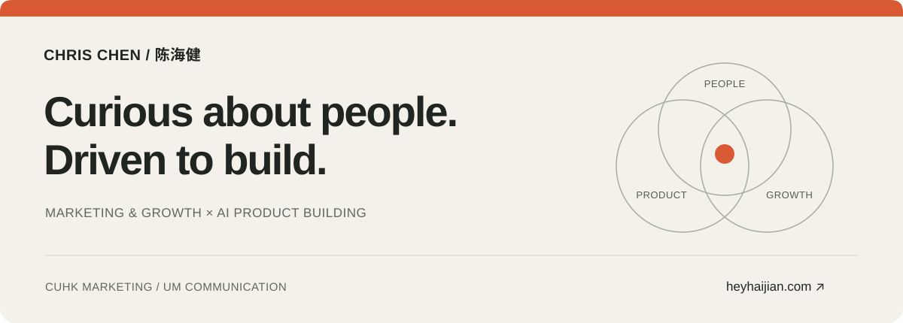
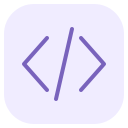

<picture>
  <source media="(prefers-color-scheme: dark) and (max-width: 600px)" srcset="./assets/cover-mobile-dark.svg">
  <source media="(max-width: 600px)" srcset="./assets/cover-mobile.svg">
  <source media="(prefers-color-scheme: dark)" srcset="./assets/cover-dark.svg">
  
</picture>

 

  <a href="https://heyhaijian.com/">我的网站</a> &nbsp; · &nbsp;
  <a href="#user-content-thoughts">最近在想</a> &nbsp; · &nbsp;
  <a href="#user-content-making">动手做的东西</a>

 

### 想冲 AI，也想亲手做出点东西。

我是 Chris，市场学背景，正在往 AI 应用和产品体验里走。现在在香港中文大学读市场学硕士，本科在澳门大学读传播学，过去在影石 Insta360 和正浩 EcoFlow 做过海外营销相关实习。

我喜欢琢磨一个功能为什么这样设计、一个流程为什么走不通，也喜欢有创造力的产品表达。借助 AI，我开始把这些想法做成能打开、能操作的东西：自己的求职工作台、面试 Skills、个人网站，还有一些仍在探索的原型。

<h2 id="thoughts">最近在想</h2>

> 最近的状态很直接：想冲 AI，想站到这波变化的前面。我还在找适合自己的位置，所以会先从碰到的问题做起，看看自己能把想法推进到哪一步。能亲手改动一个东西，再实际用一用，对我很有吸引力。
>
> 我想做分析问题、解决问题的工作。具体到做东西时，我会在意：用户为什么看不懂这里？这一步为什么还要反复手动做？如果换个流程，会不会顺一点？我还在探索方向，也想通过实际项目弄清楚，哪些问题值得自己持续投入。
>
> 动手之后，还有很多要学。自己的项目可以反复改，也让我不断碰到更具体的问题。比如求职工具能不能保留用户已经填好的内容，面试答案有没有依据；售后服务里，用户改变了目标，流程能不能跟着调整。这些细节会让我回过头去重想最初的方案。

 

<h2 id="making">动手做的东西</h2>

### [求职 Buddy](https://github.com/chenhaijain0129-coder/job-search-buddy)

求职时，岗位、经历素材和准备记录很容易散在不同地方。我把它们放进一个本地优先的 Chrome 工作台，支持岗位管理、面试准备、复盘和辅助填表，也可以选择连接模型。

做这个项目时，我会反复遇到很小、但影响使用的问题：填表时怎样保留原来的内容，经历怎样复用，哪些信息需要用户先确认。它给了我一个持续琢磨流程和体验的地方。

[查看项目](https://github.com/chenhaijain0129-coder/job-search-buddy) &nbsp; · &nbsp; Chrome 扩展 / 持续迭代

 

### 面试里的方法，也可以做成工具

准备面试时，我会把岗位要求和真实经历放在一起梳理；群面则需要尽快比较方案、做出取舍。我把这两类准备过程整理成了可安装的 Codex Skills。

[Interview Prep](https://github.com/chenhaijain0129-coder/interview-prep-skill) &nbsp; · &nbsp; [Group Interview](https://github.com/chenhaijain0129-coder/group-interview-skill)

 

### 还有一些探索

[ROLL](https://github.com/chenhaijain0129-coder/afterframe-api) 是一个私人视觉日记原型，默认以演示模式运行。我也在通过[个人网站](https://heyhaijian.com/)整理自己的经历与作品，继续尝试内容和界面可以怎样表达。

在黑客松团队项目 **FixProof** 里，我参与了消费电子 AI 售后服务的产品定义、场景梳理和前端体验迭代。用户同时有多个诉求、试过的步骤没用、想换一种处理方式时，服务应该怎样继续？我们用预设场景驱动的交互原型来探索这些问题。

 

### 关于接下来

我想继续往 AI 应用和产品体验里走，也想把海外营销里积累的产品理解与表达带进去。接下来，希望能更多接触真实使用中的问题，把一个具体的改善推进到落地。

如果你也在做 AI 工具、Agent Skills，或正在探索相近的方向，欢迎在项目里交流。我的经历与作品也放在 [heyhaijian.com](https://heyhaijian.com/)。

