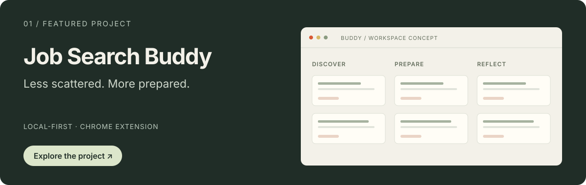
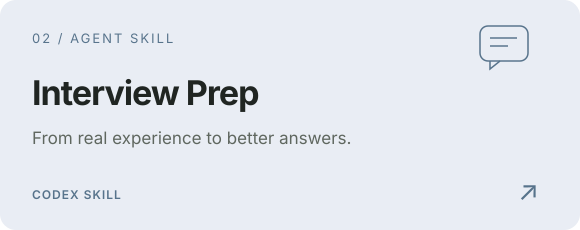
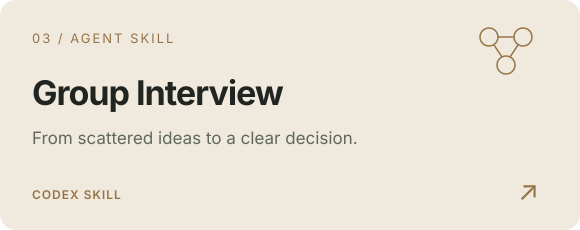

  <a href="https://heyhaijian.com/"><b>个人网站 ↗</b></a> &nbsp; / &nbsp;
  <a href="#user-content-selected-work">作品</a> &nbsp; / &nbsp;
  <a href="#user-content-a-little-context">关于我</a> &nbsp; / &nbsp;
  <a href="#user-content-lets-connect">交流</a>

 

### 把对人的好奇，变成可以使用的产品。

Hi，我是 **Chris · 陈海健**。从海外营销到 AI 工具实践，我关注产品如何被理解，也喜欢亲手改善使用它的过程。

香港中文大学市场学硕士在读 · 澳门大学传播学本科。曾在 **Insta360 影石**、**EcoFlow 正浩**参与海外营销相关实习，现在持续探索 **AI 应用、产品运营、用户体验与海外增长**。

Marketing background. Product curiosity. Building useful things with AI.

 

<h2 id="selected-work">Selected work  / 作品</h2>

**[求职 Buddy ↗](https://github.com/chenhaijain0129-coder/job-search-buddy)** · 从自己反复遇到的求职问题出发，把岗位、履历素材、面试准备和复盘放进一个工作台。

`Chrome 扩展` `本地优先` `可选 AI 助手`

支持岗位管理、经历整理、辅助填表与面试复盘。公开版初始资料为空，由使用者自行添加个人资料。

 

<table>
<tr>
<td width="50%" valign="top">

<h3><a href="https://github.com/chenhaijain0129-coder/interview-prep-skill">面试准备 ↗</a></h3>

从岗位与真实经历出发，组织项目故事、模拟追问与面后复盘，让准备更贴近自己。

<code>Codex Skill</code> <code>面试准备</code>

</td>
<td width="50%" valign="top">

<h3><a href="https://github.com/chenhaijain0129-coder/group-interview-skill">群面讨论 ↗</a></h3>

拆解无领导小组讨论题，比较方案与取舍，把分散的观点推进为可执行、可汇报的结论。

<code>Codex Skill</code> <code>结构化讨论</code>

</td>
</tr>
</table>

**Also exploring — [ROLL ↗](https://github.com/chenhaijain0129-coder/afterframe-api)**  
以影像记录日常的私人视觉日记原型；默认以演示模式运行，可配置 Supabase。

 

<h2 id="a-little-context">A little context  / 经历与视角</h2>

**01 &nbsp; 理解产品，如何走近用户**  
在消费电子海外营销实习中，接触新品内容、社群与 UGC、广告素材及用户评论研究，关注卖点如何对应到人群、场景与表达。

**02 &nbsp; 把复杂的流程，变得清楚一点**  
在黑客松团队项目 **FixProof** 中，参与消费电子 AI 售后服务方案的产品定义、场景梳理、前端体验迭代与材料协调。成果为预设场景驱动的交互原型。

**03 &nbsp; 从自己的问题出发，持续动手**  
用求职 Buddy 整理求职流程，用 Agent Skills 沉淀可复用的方法，也通过[个人网站](https://heyhaijian.com/)实践内容组织和界面体验。

 

> **理解问题 → 梳理流程 → 做出原型 → 实际使用 → 继续迭代**  
> 我借助 AI 推进实现，也持续核对：用户要完成什么、流程能否走通、哪些想法还需要验证。

 

<h2 id="lets-connect">Let's connect  / 一起交流</h2>

欢迎聊聊 **AI 工具、Agent Skills、产品体验与海外增长**。可以在相关仓库提交 Issue，或从[个人网站 ↗](https://heyhaijian.com/)找到我。

---

CHRIS CHEN &nbsp; · &nbsp; PEOPLE / PRODUCT / GROWTH

